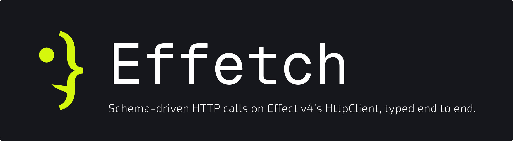

<h1>
  
</h1>

[](https://www.npmjs.com/package/@monarcode/effetch)
[](https://github.com/monarcode/effetch/actions/workflows/ci.yml)
[](https://bundlejs.com/?q=@monarcode/effetch&treeshake=%5B*%5D&config=%7B%22esbuild%22%3A%7B%22external%22%3A%5B%22effect%22%2C%22effect%2F*%22%5D%7D%7D)
[](https://www.npmjs.com/package/@monarcode/effetch)
[](https://www.npmjs.com/package/@monarcode/effetch#provenance)
[](./LICENSE)

[](https://effect.website)
[](https://effetch.monarcode.dev/docs/platforms#browsers)
[](https://effetch.monarcode.dev/docs/platforms#react-native)
[](https://effetch.monarcode.dev/docs/platforms#react-native)
[](https://effetch.monarcode.dev/docs/platforms)
[](https://effetch.monarcode.dev/docs/platforms)
[](https://effetch.monarcode.dev/docs/platforms)

**Typed HTTP calls for [Effect](https://effect.website), without the
boilerplate.**

You give Effetch a path and a schema. It fills in the path, builds the
query, sends the request, checks the status and decodes the response. What
you get back is an Effect that's typed end to end, errors included, so
TypeScript tells you what a call returns and every way it can fail.

```ts
import * as Effect from "effect/Effect";
import * as Schema from "effect/Schema";

import { Fetch } from "@monarcode/effetch";

const Todo = Schema.Struct({ id: Schema.Finite, title: Schema.String });

class Api extends Fetch.Service<Api>()("Api", {
  baseUrl: "https://api.example.com",
}) {}

export const getTodo = (id: number) =>
  Effect.gen(function* () {
    const api = yield* Api;
    return yield* api.get("/todos/:id", { params: { id }, output: Todo });
  });
// Effect<{ readonly id: number; readonly title: string },
//        NetworkError | DecodeError | HttpError, Api>
```

> **Release candidate.** Effetch is in release candidates (`0.1.0-rc.N`)
> on the way to `0.1.0`. A release candidate can still change the API, and
> when one does, the [changelog](./CHANGELOG.md) says what to change in your
> code.

## Documentation

The guides and the API reference are at
**[effetch.monarcode.dev/docs](https://effetch.monarcode.dev/docs)**.

## Install

```bash
pnpm add @monarcode/effetch effect
```

You'll need:

- `effect` 4.x, which is a peer dependency;
- an ESM project, since the package is ESM only;
- TypeScript 5.7 or newer.

[Compatibility](https://effetch.monarcode.dev/docs/reference/compatibility)
lists the runtimes Effetch is built for, and which of them CI tests.

## Quick start

This program fetches a todo from
[JSONPlaceholder](https://jsonplaceholder.typicode.com), a free fake API,
and decodes it with a schema:

```ts
import * as Effect from "effect/Effect";
import * as FetchHttpClient from "effect/http/FetchHttpClient";
import * as Layer from "effect/Layer";
import * as Schema from "effect/Schema";

import { Fetch } from "@monarcode/effetch";

// 1. What a todo looks like
const Todo = Schema.Struct({
  id: Schema.Finite,
  title: Schema.String,
  completed: Schema.Boolean,
});

// 2. The client, declared once for the whole app
class Api extends Fetch.Service<Api>()("Api", {
  baseUrl: "https://jsonplaceholder.typicode.com",
}) {}

// 3. A call
const program = Effect.gen(function* () {
  const api = yield* Api;
  const todo = yield* api.get("/todos/:id", {
    params: { id: 1 },
    output: Todo,
  });
  console.log(todo.title);
});

// 4. Run it, with the client and the HttpClient that sends the requests
const ApiLive = Api.layer.pipe(Layer.provide(FetchHttpClient.layer));

await Effect.runPromise(program.pipe(Effect.provide(ApiLive)));
```

`Api` is your client, declared once for the whole app. `api.get` fills in
`:id` from `params`, sends the request and decodes the body with `Todo`.
`Api.layer` builds the client, with the `HttpClient` that sends the
requests. [Getting started](https://effetch.monarcode.dev/docs/getting-started)
walks through each part.

Calling an API from a web page on another origin? Read
[Platform notes](https://effetch.monarcode.dev/docs/platforms) first.

## Guides

- [Clients](https://effetch.monarcode.dev/docs/clients): declare a client, configure it and
  provide it.
- [Calls](https://effetch.monarcode.dev/docs/calls): methods, parameters, bodies, uploads and
  responses.
- [Errors](https://effetch.monarcode.dev/docs/errors): what a call can fail with, and how to
  catch and type each error.
- [Endpoints](https://effetch.monarcode.dev/docs/endpoints): save routes with their schemas and
  share them as a service.
- [Plugins](https://effetch.monarcode.dev/docs/plugins): auth, retries, timeouts and logging, and
  writing your own.
- [Streaming responses](https://effetch.monarcode.dev/docs/streaming) and
  [Pagination](https://effetch.monarcode.dev/docs/pagination).
- [Structure an app](https://effetch.monarcode.dev/docs/structuring-an-app).
- [Testing](https://effetch.monarcode.dev/docs/testing): test calls against a fake backend made
  from your endpoints.
- [Platform notes](https://effetch.monarcode.dev/docs/platforms): browsers and React Native.
- [Coming from axios or ky](https://effetch.monarcode.dev/docs/coming-from-axios-or-ky).
- [Upgrade from 0.1.0-rc.3](https://effetch.monarcode.dev/docs/upgrading).
- [Reference](https://effetch.monarcode.dev/docs/reference): every export of
  `Fetch`, the plugins and `FetchTest`, with
  [Compatibility](https://effetch.monarcode.dev/docs/reference/compatibility) and
  [Limitations](https://effetch.monarcode.dev/docs/reference/limitations).

## Examples

[`examples/`](examples) has complete programs, typechecked with the package so
they always match the current API:

- [`basic.ts`](examples/basic.ts): a client in a service, the methods, and
  handling each error.
- [`builtins.ts`](examples/builtins.ts): the built-in plugins, and changing
  them for one call.
- [`plugins.ts`](examples/plugins.ts): writing plugins, from auth with a
  service to a `wrap` with its own error.
- [`endpoints.ts`](examples/endpoints.ts): the same app as `builtins.ts`, with
  endpoints.
- [`backends.ts`](examples/backends.ts): two backends in one file, with shared
  plugins.
- [`status-errors.ts`](examples/status-errors.ts): your own errors by status,
  for every call, per endpoint and for one call.
- [`streams.ts`](examples/streams.ts): Server-Sent Events, newline-delimited
  JSON, and a list paged through by its `Link` header.
- [`testing.ts`](examples/testing.ts): tests for the `app/` todos module,
  against a fake backend made from its endpoints.
- [`app/`](examples/app): a feature-sliced app, with clients as shared
  infrastructure and each module defining its own endpoints.

Its [README](examples/README.md) walks through each one.

## Development

You need Node 24 and pnpm 10.12.1 (`corepack enable` picks the pinned
version).

```bash
pnpm install
pnpm run check
```

| Script                    | What it does                                                                                                                                                                                              |
| ------------------------- | --------------------------------------------------------------------------------------------------------------------------------------------------------------------------------------------------------- |
| `pnpm run build`          | Builds `dist/` (ESM and `.d.ts`) with tsdown.                                                                                                                                                             |
| `pnpm test`               | Runs the tests and type tests with Vitest.                                                                                                                                                                |
| `pnpm run typecheck`      | Typechecks `src`, `test` and `examples`.                                                                                                                                                                  |
| `pnpm run lint`           | Lints with oxlint (`lint:effect` runs the Effect language service).                                                                                                                                       |
| `pnpm run format`         | Formats with oxfmt (`format:check` only checks).                                                                                                                                                          |
| `pnpm run check:docs`     | Checks every public export has a description, `@example` and `@since`, compiles every example in the JSDoc, this README and the docs site's pages, and checks the site's API reference matches the JSDoc. |
| `pnpm run smoke`          | Packs the package, installs it in a fresh project, typechecks and runs a consumer, and checks go-to-definition, hovers and completions.                                                                   |
| `pnpm run check`          | All of the above, plus publint and attw. CI runs it on every push to `main` and every pull request.                                                                                                       |
| `pnpm run compat`         | After `smoke`, checks the installed package (not part of `check`; CI runs it) with another TypeScript version or runtime: `pnpm run compat typescript 5.7`, or `runtime node`, `bun` or `deno`.           |
| `pnpm run build:site`     | Builds the package, then prerenders the docs site in `site/` to `site/dist/client`, failing on a type error in an example. `check` doesn't build the site; CI does.                                       |
| `pnpm run docs:reference` | Writes the site's API reference pages from the JSDoc. Run it after changing a public export or its docs.                                                                                                  |
| `pnpm run docs:snapshot`  | Freezes an older release line's docs into the site, such as `pnpm run docs:snapshot 0.1` when `0.2` starts.                                                                                               |

To work on the docs site, run `pnpm run build`, then `pnpm --dir site run dev`.
The site's type hovers and tables read the built package, so build again
after changing `src/`.

The pre-commit hook runs `lint` and `format:check`.

## License

[MIT](LICENSE)
